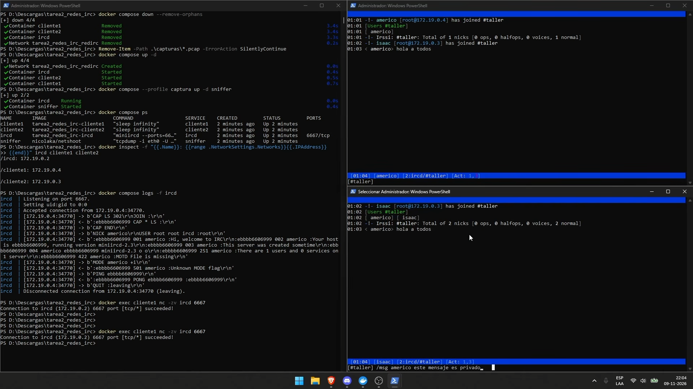
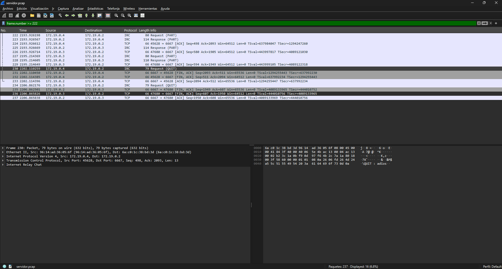

# Tarea 2: Análisis de tráfico del protocolo IRC
> Servidor y cliente IRC desplegados en contenedores Docker, con captura y análisis del tráfico que generan.
> Video demostración: [_aquí_](https://drive.google.com/file/d/16qYT4aq5K85bpq7b2wWTxLYyzmJBDmJX/view?usp=sharing). <!-- Reemplazar por el enlace al video (máx. 8 minutos). -->

## Tabla de contenidos
* [Información general](#información-general)
* [Tecnologías utilizadas](#tecnologías-utilizadas)
* [Características](#características)
* [Capturas de pantalla](#capturas-de-pantalla)
* [Instalación](#instalación)
* [Uso](#uso)
* [Estado del proyecto](#estado-del-proyecto)
* [Posibles mejoras](#posibles-mejoras)


## Información general
- Este repositorio contiene el trabajo de la **Tarea 2**: elegir un protocolo, instalar una dupla de software (servidor y cliente) en contenedores, hacer que se comuniquen y estudiar el tráfico que generan.
- El protocolo en este caso es **IRC (Internet Relay Chat)**, un sistema de chat en tiempo real organizado en canales y mensajes privados, que funciona sobre TCP y usa mensajes de texto.
- La dupla de software es:
  - **Servidor:** [miniircd](https://github.com/jrosdahl/miniircd), un servidor IRC pequeño escrito en Python.
  - **Cliente:** [irssi](https://github.com/irssi/irssi), un cliente IRC para terminal.
- El propósito es dejar un entorno **reproducible** (cualquier persona puede levantarlo con Docker Compose) y un conjunto de **capturas de tráfico**, que luego se analizan en el informe.


## Tecnologías utilizadas
- Docker - versión: 29.9.3, build 5457199
- Docker Compose v2 - versión: 5.7.0
- miniircd - instalado desde PyPI sobre la imagen `python:3.12-slim`
- irssi - instalado desde los repositorios de `debian:bookworm-slim`
- tcpdump (imagen `nicolaka/netshoot`)
- Wireshark - versión: 4.6.9


## Características
- Servidor IRC y dos clientes irssi, cada uno en su propio contenedor, conectados por una red Docker dedicada (`redirc`).
- Resolución de nombres automática entre contenedores (los clientes se conectan a `ircd`).


## Capturas de pantalla
<!-- Agregar las imágenes en la carpeta ./img y ajustar los nombres de archivo. -->




## Instalación
### Requisitos
- Docker Engine con Docker Compose v2.
- Git.
- Wireshark (opcional, para analizar las capturas).

### Estructura del repositorio
```
.
├── docker-compose.yml
├── server/
│   └── Dockerfile 
├── client/
│   └── Dockerfile
├── captura/         
├── img/               # capturas de pantalla para este README
├── informe/           # informe del grupo
└── README.md
```

### Pasos
1. Clonar el repositorio:
   ```bash
   git clone <URL-del-repositorio>
   cd <carpeta-del-repositorio>
   ```
2. Construir las imágenes y levantar los contenedores:
   ```bash
   docker compose up -d --build
   ```
3. Verificar que los tres contenedores estén en estado `Up`:
   ```bash
   docker compose ps
   ```
4. Detener y eliminar todo cuando se termine:
   ```bash
   docker compose down
   ```

### Contenedores
| Contenedor | Software | Función |
|---|---|---|
| `ircd` | miniircd | Servidor IRC, escucha en el puerto TCP 6667 (texto plano) |
| `cliente1` | irssi | Primer cliente |
| `cliente2` | irssi | Segundo cliente |
| `sniffer` | tcpdump | Captura el tráfico del servidor (solo con `--profile captura`) |


## Uso
### Conectar los clientes
En dos terminales distintas:
```bash
docker exec -it cliente1 irssi -c ircd -p 6667 -n americo
docker exec -it cliente2 irssi -c ircd -p 6667 -n isaac
```
Dentro de irssi:
```
/join #taller               # entrar a un canal
Hola a todos                # mensaje al canal
/msg companero hola         # mensaje privado
/names #taller              # usuarios del canal
/quote PING prueba          # PING manual al servidor
/part #taller               # salir del canal
/quit adios                 # desconectarse
```

### Ver los registros del servidor
```bash
docker compose logs -f ircd
```

### Capturar tráfico
El archivo 

Tipos de tráfico capturados:

| N° | Tipo de tráfico |
|---|---|---|
| 1 | Apertura de conexión TCP | 
| 2 | Registro del usuario (`NICK`, `USER`) |
| 3 | Bienvenida y mensaje del día | 
| 4 | Entrada a un canal (`JOIN`) | 
| 5 | Mensaje a un canal (`PRIVMSG`) | 
| 6 | Mensaje privado | 
| 7 | Keep-alive (`PING`/`PONG`) | 
| 8 | Consultas (`NAMES`, `LIST`, `WHOIS`) | 
| 9 | Errores del servidor | 
| 10 | Cierre (`PART`, `QUIT`, fin de TCP) | 

<!-- Ajustar la tabla a las capturas que realmente se entreguen. -->

### Problemas frecuentes
- **`irssi` no conecta:** comprobar que `ircd` esté en ejecución (`docker compose ps`) y usar el nombre `ircd`, no `localhost`.
- **Wireshark no muestra paquetes:** en Docker Desktop (Windows o macOS) la interfaz `br-...` no es visible desde el equipo; usar el contenedor `sniffer` o `tcpdump` dentro del cliente.
- **Archivo `.pcap` que no se puede abrir:** el contenedor lo crea como root; ejecutar `sudo chown -R $USER captura/`.


## Estado del proyecto
Proyecto: _en progreso_. La Tarea 2 incluye los capítulos 1 y 2 del informe y el video de demostración. El capítulo 3 (modificación de tráfico y análisis de métricas) se desarrollará en la Tarea 3.


## Posibles mejoras
Posibles mejoras:
- Usar IRC sobre TLS (puerto 6697) y comparar el tráfico cifrado con el de texto plano.
- Crear archivos específicos para cada tipo de tráfico.
- Probar otros servidores y clientes IRC para comparar el comportamiento.

Por hacer:
- Modificar tráfico y analizar métricas (Tarea 3).
